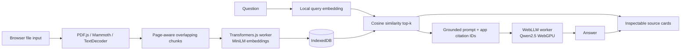

# LocalDoc AI

Private, browser-based retrieval-augmented generation for PDF, DOCX, TXT, and Markdown files. Documents, embeddings, retrieval, questions, and generation stay on the user’s device; only open model assets are downloaded.

## Features

- Local PDF.js, Mammoth, and plain-text extraction
- Overlapping chunks with filename and PDF page metadata
- Local MiniLM embeddings and cosine-similarity retrieval
- Local WebLLM generation using WebGPU
- Application-owned, inspectable source citations
- IndexedDB persistence, duplicate detection, deletion, and full data clearing
- Explicit handling for unsupported formats, encrypted/scanned PDFs, storage limits, and missing WebGPU

## Quick start

```bash
npm install
npm run dev
```

Open the URL printed by Vite in a current desktop Chromium browser. Production commands:

```bash
npm test
npm run build
npm run preview
```

## Architecture



There is no application backend. Static assets are served by the host; model files are fetched by the browser from Hugging Face/WebLLM distribution endpoints and cached locally.

### RAG pipeline

1. Validate extension and size, then hash the file with SHA-256 to avoid repeat indexing.
2. Extract PDF text page-by-page, DOCX text with Mammoth, or UTF-8 text directly.
3. Split each page into 180-word chunks with 30-word overlap.
4. Create normalized 384-dimensional embeddings in a Web Worker and store chunks and typed arrays in IndexedDB.
5. Embed each question, rank every stored chunk by cosine similarity, and keep the six best passages.
6. Decline automatically when the strongest similarity score is below `0.22`.
7. Assign `SRC-1`, `SRC-2`, and so on to the retrieved chunks and send only those passages to the local model.
8. Remove any model-written citation that is not in the application’s retrieved-source map. Source cards always reference the actual stored chunks, never model-created metadata.

## Models and runtimes

| Role | Exact identifier | Runtime | License | Approximate first download |
|---|---|---|---|---:|
| Embeddings | `Xenova/all-MiniLM-L6-v2` (`q8` ONNX) | `@huggingface/transformers` 4.3.2 | Apache-2.0 | ~23 MB |
| Generation | `mlc-ai/Qwen2.5-0.5B-Instruct-q4f16_1-MLC` / runtime ID `Qwen2.5-0.5B-Instruct-q4f16_1-MLC` | `@mlc-ai/web-llm` 0.2.88 | Apache-2.0 | ~350–450 MB |

The selected Qwen runtime ID is present in WebLLM 0.2.88’s `prebuiltAppConfig`. It resolves to the Hugging Face MLC repository above and the `Qwen2-0.5B-Instruct-q4f16_1_cs1k-webgpu.wasm` model library, with a 4,096-token context override and approximately 944.62 MB declared VRAM requirement. The application also checks the runtime registry before loading.

MiniLM was selected for compact, fast English semantic retrieval. Qwen2.5-0.5B was selected as the smallest supported quantized Qwen instruct model with a permissive license. Its small size also limits reasoning quality; retrieval quality and source inspection remain important.

## Browser requirements

- Current desktop Chrome or Edge with WebGPU and a usable GPU adapter
- HTTPS in production or `localhost` during development
- Recommended: 8 GB system memory, roughly 1 GB free GPU memory, and at least 500 MB available browser storage
- Network access for the first model download; later runs use the browser cache when available

Extraction, indexing, and retrieval use browser-compatible CPU/WASM execution. If WebGPU or an adapter is unavailable, the application preserves retrieved evidence but refuses generation; it never switches to cloud inference.

## Privacy and security

- Documents, extracted text, embeddings, questions, and answers are not sent to an application server.
- No authentication, analytics, telemetry, cloud database, or synchronization is included.
- Source passages are delimited and treated as untrusted content, but prompt injection cannot be eliminated completely.
- IndexedDB and Cache Storage are origin-local, yet browser data may be inspected by someone with access to the same browser profile.
- “Clear all local data” clears the application database, chat state, and this origin’s model caches after confirmation.
- Browser storage may be evicted and is not a backup. Keep the original documents.
- Model downloads reveal the visitor’s IP address to the model host under that host’s policies.
- Version 1 has no OCR. Image-only PDFs are reported as unsupported.

## Limits

- 25 MB maximum input file size
- 2,000,000 extracted characters per file
- Text-based PDF only; encrypted/password-protected PDFs are rejected
- DOCX page numbers are unavailable because DOCX stores flowing content rather than stable rendered pages
- English retrieval model; other languages may perform poorly
- A 0.5B generator can miss nuance even with good retrieved context

## Tests

`npm test` covers chunk overlap, page metadata, cosine ranking, application citation filtering, and file validation. `tests/fixtures` contains only synthetic data, including generated PDF and DOCX files. Rebuild binary fixtures with:

```bash
python3 tests/create_fixtures.py
```

Browser validation should include:

1. Upload all synthetic fixtures and wait for each status to become ready.
2. Ask “What is the internal launch code name?” and inspect `SRC-1` for “Juniper Lantern.”
3. Ask “What is the observatory password phrase?” and verify the PDF page 1 passage contains “Silver Orchard.”
4. On a WebGPU machine, allow the Qwen download and verify the streamed answer cites only displayed `SRC-*` identifiers.
5. Remove one document, reload, and confirm it remains deleted; then use Clear All Data.

## Independent deployment

The output is a static site:

```bash
npm ci
npm run build
```

Publish the contents of `dist/` to any HTTPS static host, including MuleRun Pages or GitHub Pages. The host must serve `.js`, `.mjs`, and `.wasm` with appropriate MIME types and must not block workers or Hugging Face model requests through its Content Security Policy. WebGPU computation runs on the visitor’s device; the host does not need a GPU.

For GitHub Pages, configure the repository’s Pages source to a workflow that runs the commands above and uploads `dist/`. The app does not use client-side routes, so no history fallback is required.

## License

Application source is released under the [MIT License](LICENSE). Model weights are separate works governed by their Apache-2.0 licenses. Major runtime dependencies use permissive licenses; retain their notices when redistributing.
